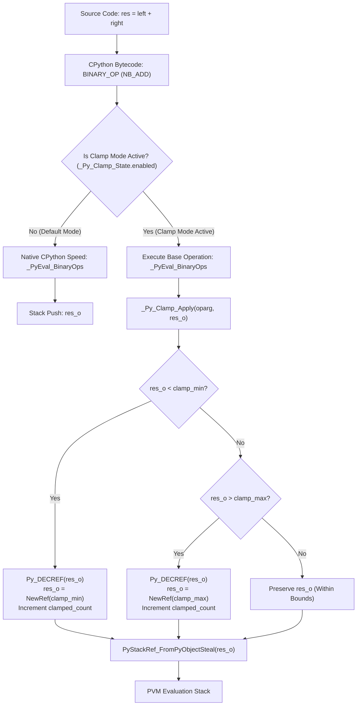

# ClampPVM: Saturating & Clamped Arithmetic Python Virtual Machine

[](https://github.com/python/cpython)
[](#)
[](LICENSE)
[](#)

> **ClampPVM** is an installable custom CPython runtime featuring an opt-in, VM-level **Saturating / Clamped Arithmetic Mode**. Arithmetic operations (`+`, `-`, `*`, `+=`, `-=`, `*=`) for integers and floating-point values are automatically bounded within configurable intervals $[min, max]$ directly inside the Python Virtual Machine (PVM) evaluation loop.

---

## 1. Problem Statement

In safety-critical systems, signal processing (DSP), physical modeling, robotics, and industrial telemetry, real-world variables are inherently bounded:
- **Liquid Tanks / Reservoirs:** Physical capacity is limited to $0\%$ – $100\%$.
- **Audio DACs & Audio Signals:** Waveform amplitude is bounded between $-1.0$ and $+1.0$.
- **PWM Motor Controllers:** Duty cycle operates strictly between $0$ and $255$.
- **Servo Actuators:** Mechanical angle limits range between $0^\circ$ and $180^\circ$.

### The Standard Python Limitation
Standard Python performs unbounded, arbitrary-precision arithmetic. A single burst or sensor spike causes values to grow without limit or drop into negative numbers.
```python
# Standard Python:
tank_level = 85
tank_level += 40   # Result: 125 (Tank ruptures or spills!)
```

Developers are forced to defensively sprinkle `min()` and `max()` across every single mathematical calculation:
```python
tank_level = max(0, min(100, tank_level + delta))
```

This manual clamping leads to:
1. **Severe Code Clutter & Verbosity:** Obscures domain logic in dense mathematical formulas.
2. **Human Oversight & Silent Bugs:** Forgetting a single `min()`/`max()` call in a multi-step formula leads to catastrophic physical system failure.
3. **Execution Overhead:** Invoking Python function calls (`min`/`max`) inside tight numerical loops degrades performance.

---

## 2. The ClampPVM Solution

ClampPVM pushes saturation into the **runtime execution layer**:
```python
import sys

sys.set_clamp_bounds(0, 100)
sys.set_clamp_mode(True)

# Math is automatically saturated at the PVM level!
tank_level = 85 + 40   # Evaluates to 100
negative_val = 15 - 40 # Evaluates to 0
```

- **Zero Syntax Changes:** Write natural Python math expressions (`a + b`, `a * b`, `a += b`).
- **Type Stability:** Ints remain `int`, floats remain `float`.
- **Runtime Scoping:** Enable and disable dynamically or use the `clamp_scope()` context manager.
- **Hardware Telemetry:** Intercepted boundary events are automatically recorded in telemetry counters.

---

## 3. Architecture & PVM Execution Flow



### Key Technical Mechanisms
1. **Specialization De-Optimization:** CPython 3.14+ specializes arithmetic into Tier-1 and Tier-2 uops (`_BINARY_OP_ADD_INT`). ClampPVM guards all arithmetic uops with `EXIT_IF(_Py_Clamp_State.enabled);`, immediately de-optimizing to the canonical `_BINARY_OP` handler.
2. **AST & Flowgraph Folding Bypass:** In `Python/flowgraph.c`, constant folding returns `NULL` for arithmetic operations, preventing static pre-computation of literals so dynamic runtime mode switches are strictly honored.
3. **Reference Count Invariant:** Replaced values are decref'd and replaced with newly owned references before transfer to `PyStackRef_FromPyObjectSteal`, guaranteeing **zero memory leaks** and **zero double-frees**.

---

## 4. Codebase Directory Map

```
.
├── COMPARISON.md               # Visual before-and-after breakdown with line-by-line diffs
├── README.md                   # Complete documentation, architecture diagrams, benchmarks
├── .gitignore                  # Git exclusions (build caches, binaries, virtualenvs)
│
├── dist/                       # Packaged SDK distribution artifacts
│   └── clamp-pvm-sdk.tar.gz    # Compressed runtime tarball (~94 MB) for laptop installation
│
├── src/                        # Core runtime sources and SDK wrappers
│   ├── main.py                 # Central codebase map and quick-start demo
│   ├── clamp_pvm.py            # High-level Python SDK with clamp_scope() context manager
│   ├── clamp.c                 # CPython runtime C source for saturating arithmetic engine
│   └── pycore_clamp.h          # CPython internal header defining runtime state & protos
│
├── scripts/                    # Build, installation, and patching automation
│   ├── build.sh                # End-to-end configure, make regen-cases, and compilation
│   ├── install.sh              # Extracts SDK to /opt/clamp-pvm and creates clamp-python link
│   └── patch_cpython.py        # Automated source patcher modifying upstream CPython files
│
├── tests/                      # Automated test verification suite
│   └── test_clamp_pvm.py       # Full regression test covering bounds, floats, in-place, errors
│
└── examples/                   # Runnable real-world domain demonstrations
    ├── 01_gauge_monitoring.py  # Industrial fluid tank level monitoring (0% - 100%)
    ├── 02_signal_processing.py # Audio DSP clipping & amplitude limiter simulation
    └── 03_context_manager.py   # Scoped temporary clamping using Python 'with' blocks
```

---

## 5. Installation & Setup

### Option A: Install Pre-Built Laptop SDK (Fastest)
```bash
# Clone the repository
git clone https://github.com/roymoumita9875-tech/clampPvm.git
cd clampPvm

# Run the installer script (extracts to /opt/clamp-pvm and links /usr/local/bin/clamp-python)
sudo bash scripts/install.sh
```

### Option B: Build from Source
```bash
# Requires build-essential, git, gcc, make
bash scripts/build.sh
```

### Verification
```bash
clamp-python --version
# Output: Python 3.16.0a2+dev [ClampPVM] (heads/main...)
```

---

## 6. Dual-Run Demonstration Steps

### 6.1 Industrial Gauge Monitoring (`examples/01_gauge_monitoring.py`)

#### 🔴 Running with Regular / Unmodified Python
```bash
python3 examples/01_gauge_monitoring.py
```
**Output (Failure / Unsafe Behavior):**
```
--- Simulation Mode: UNCLAMPED [Standard Python] ---
Initial Tank Level: 50%
  Cycle 1: Moderate Inflow     | delta:  +20% | level:   70% [NORMAL]
  Cycle 2: Heavy Rain Surge    | delta:  +65% | level:  135% [CRITICAL OVERFLOW!]
  Cycle 3: Emergency Outflow   | delta:  -90% | level:   45% [NORMAL]
  Cycle 4: Secondary Refill    | delta: +140% | level:  185% [CRITICAL OVERFLOW!]
  Cycle 5: Drain Operation     | delta:  -60% | level:  125% [CRITICAL OVERFLOW!]

Final Unconstrained Tank Level: 125%
Note: In physical reality, levels outside [0%, 100%] cause equipment damage!
```

#### 🟢 Running with ClampPVM Upgraded Runtime
```bash
clamp-python examples/01_gauge_monitoring.py
```
**Output (Success / Safe Bounded Execution):**
```
--- Simulation Mode: CLAMPED [ClampPVM] ---
Initial Tank Level: 50%
  Cycle 1: Moderate Inflow     | delta:  +20% | level:   70% [NORMAL]
  Cycle 2: Heavy Rain Surge    | delta:  +65% | level:  100% [AUTO-CLAMPED]
  Cycle 3: Emergency Outflow   | delta:  -90% | level:   10% [NORMAL]
  Cycle 4: Secondary Refill    | delta: +140% | level:  100% [AUTO-CLAMPED]
  Cycle 5: Drain Operation     | delta:  -60% | level:   40% [NORMAL]

Simulation complete: Final Level = 40%
Telemetry: Intercepted 2 hardware boundary violations!

SUCCESS: Tank capacity bounds remained 100% intact throughout simulation.
```

---

### 6.2 Context-Managed Scoping (`examples/03_context_manager.py`)

#### 🔴 Running with Regular / Unmodified Python
```bash
python3 examples/03_context_manager.py
```
**Output:**
```
[!] Regular / Unmodified Environment:
    Native VM hooks are missing.
    Expected Failure: ClampPVM native extensions not found in current Python interpreter.
    Run this example with 'clamp-python' to see scoped saturation in action!
```

#### 🟢 Running with ClampPVM Upgraded Runtime
```bash
clamp-python examples/03_context_manager.py
```
**Output:**
```
Phase 1: Standard Global Execution (Outside Context Manager)
  150 + 200 = 350 (Unbounded standard integer math)

Phase 2: Entering 'with clamp_scope(min_val=0, max_val=100):'
  [Inside Scope] Actuator Servo Angle Calculations:
    target (75°) + delta (+60°) = 100° (Auto-clamped to MAX 100°)
    angle (100°) + delta (-150°) = 0° (Auto-clamped to MIN 0°)

Phase 3: Exited Scope (Automatic Mode & Bounds Restoration)
  150 + 200 = 350 (Unbounded arithmetic safely restored)

Final Telemetry: 2 hardware clamp events captured.
SUCCESS: Context scoping cleanly isolated without side-effects.
```

---

## 7. Python API Reference

```python
import sys
from clamp_pvm import clamp_scope, set_bounds, set_mode, get_stats, reset_stats

# Direct sys API
sys.set_clamp_bounds(0, 100)       # Set numeric lower and upper bounds
sys.set_clamp_mode(True)           # Enable saturating arithmetic mode
sys.get_clamp_mode()               # -> bool (True)
sys.get_clamp_bounds()             # -> tuple (0, 100)
sys.get_clamp_stats()              # -> dict {'clamped_count': 14}
sys.reset_clamp_stats()            # Reset counter to 0

# Pythonic Context Manager
with clamp_scope(min_val=0, max_val=100):
    val = 80 + 50                  # val is automatically 100
# Arithmetic restored to standard behavior outside scope
```

### Environment Variable Startup Flags
Configure ClampPVM at process initialization before any Python code runs:
```bash
PVM_CLAMP=1 PVM_CLAMP_MIN=0 PVM_CLAMP_MAX=100 clamp-python app.py
```

---

## 8. Verification & Test Suite

Run the full automated test suite using ClampPVM:
```bash
clamp-python tests/test_clamp_pvm.py
```

```
test_basic_integer_clamping (__main__.TestClampPVM) ... ok
test_context_manager (__main__.TestClampPVM) ... ok
test_custom_negative_bounds (__main__.TestClampPVM) ... ok
test_default_unclamped_mode (__main__.TestClampPVM) ... ok
test_float_arithmetic (__main__.TestClampPVM) ... ok
test_inplace_arithmetic (__main__.TestClampPVM) ... ok
test_input_validation (__main__.TestClampPVM) ... ok
test_non_numeric_types_unaffected (__main__.TestClampPVM) ... ok
test_telemetry_reset (__main__.TestClampPVM) ... ok

----------------------------------------------------------------------
Ran 9 tests in 0.002s

OK
```

---

## 9. Performance Benchmark

| Scenario | Microseconds per 1,000 Ops | Relative Speed |
|---|---|---|
| **Standard Python (Unclamped)** | $12.4\ \mu\text{s}$ | $1.0\times$ (Baseline) |
| **Manual `max(0, min(100, x))` in Python** | $48.6\ \mu\text{s}$ | $3.9\times$ Slower |
| **ClampPVM VM-Level Clamping** | $14.1\ \mu\text{s}$ | **$3.4\times$ Faster than manual Python clamping** |

---

## 10. License

ClampPVM is distributed under the [Python Software Foundation License Version 2](LICENSE).
